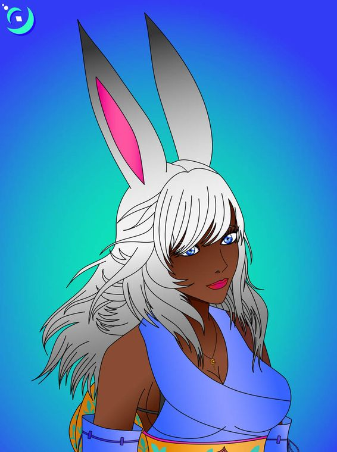
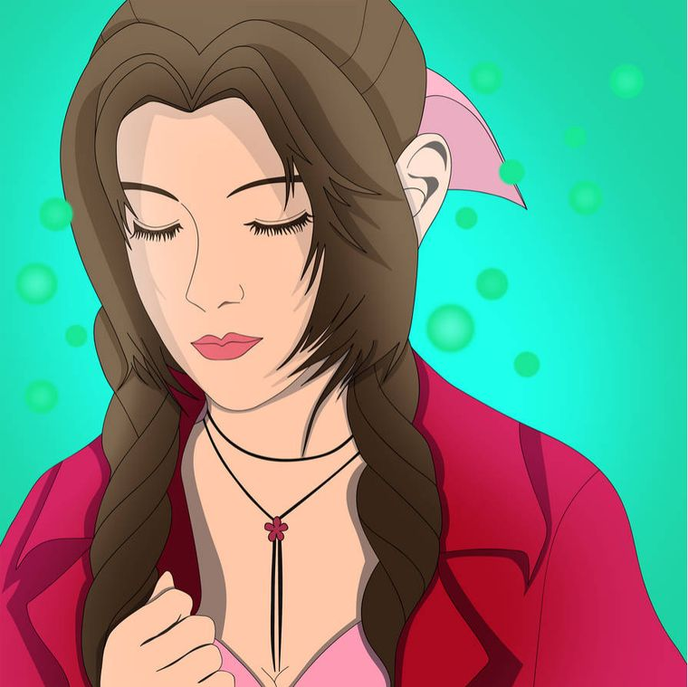
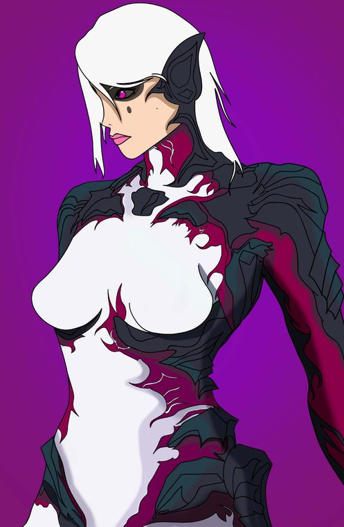
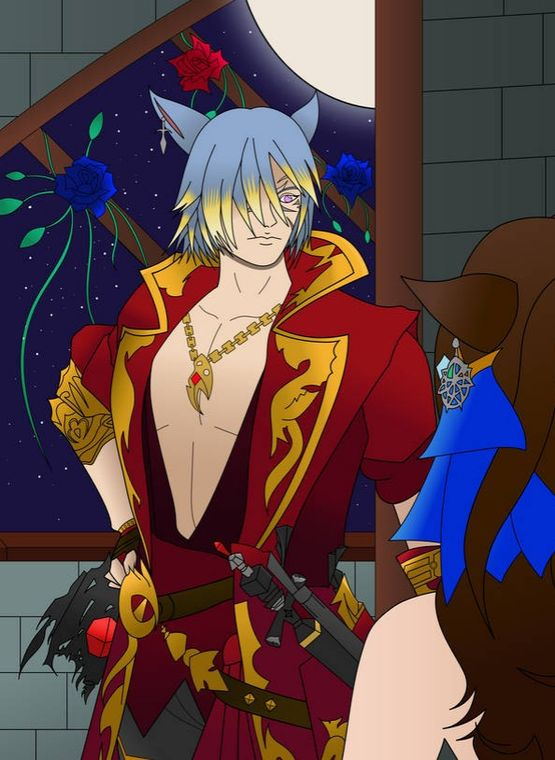
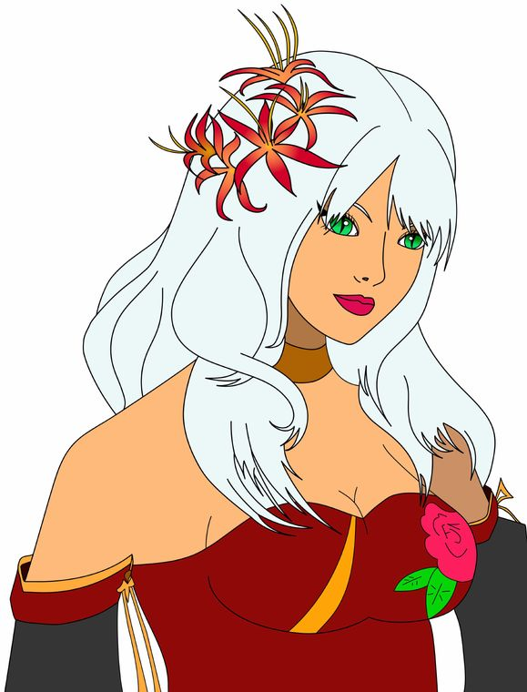
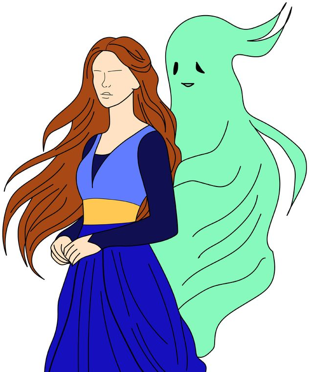

<!doctype html>
<html lang="en">
<head>
<meta charset="utf-8">
<meta name="viewport" content="width=device-width, initial-scale=1">
<title>Marie Brache | Digital media artist and designer</title>
<meta name="description" content="Portfolio of Marie Brache, a digital media artist and designer in Oviedo, Florida: professional art and personal character illustration.">
<meta name="author" content="Marie Brache">
<link rel="icon" href="data:image/svg+xml,%3Csvg xmlns='http://www.w3.org/2000/svg' viewBox='0 0 32 32'%3E%3Crect width='32' height='32' rx='7' fill='%23008080'/%3E%3Cpath d='M11 8l13 8-13 8z' fill='%23e8bb3f'/%3E%3C/svg%3E">
<link rel="stylesheet" href="assets/css/style.css">
</head>
<body>
<a class="skip" href="#main">Skip to content</a>
<header class="site-header">
  <a class="wordmark" href="index.html">Marie Brache</a>
  <nav class="menu" aria-label="Main">
    <a class="cursor-item" href="works.html">Works</a>
    <a class="cursor-item" href="about.html">About</a>
    <a class="cursor-item" href="cv.html">CV</a>
  </nav>
</header>
<main id="main">
<section class="hero" aria-label="Introduction">
  

  

    <h1 class="speaker">Marie Brache</h1>
    
Hi, I’m Marie, a digital media artist and designer in Oviedo, Florida. I draw vibrant characters inspired by the role-playing games I love, and design bold, clear guides and graphics that make technology easier to understand.

    <ul class="choices">
      <li><a class="cursor-item" href="works.html">See my work</a></li>
      <li><a class="cursor-item" href="about.html">Read my bio</a></li>
      <li><a class="cursor-item" href="cv.html">View my CV</a></li>
    </ul>
    
  

</section>
<section class="section" aria-labelledby="sel">
  

    <h2 id="sel">Selected work</h2>
    <a href="works.html">See all 22 works</a>
  

  

</section>
</main>
<footer class="site-footer">
  
Marie Brache, digital media artist and designer in Oviedo, Florida

  <nav aria-label="Contact">
    <a href="mailto:mbrache@protonmail.com">mbrache@protonmail.com</a>
    <a href="Marie_Brache_CV.pdf">Download CV (PDF)</a>
  </nav>
</footer>

</body>
</html>
